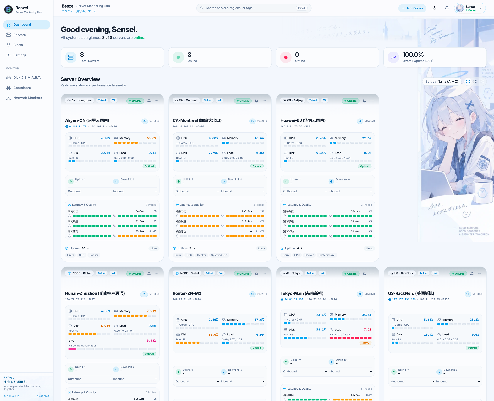
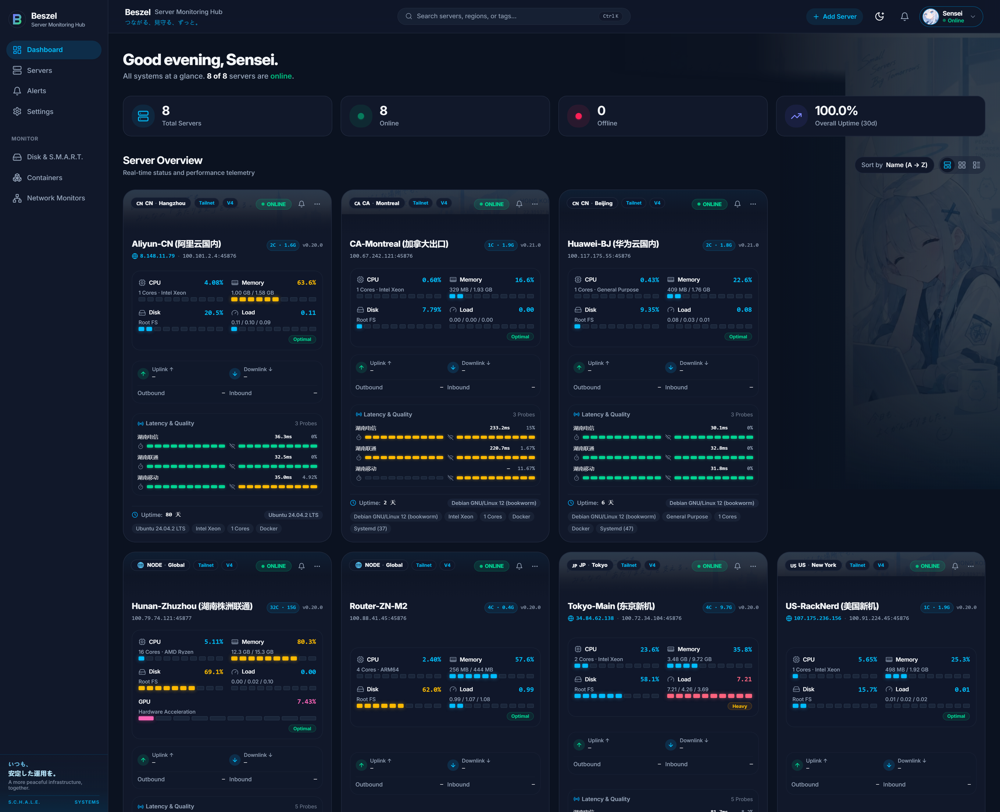
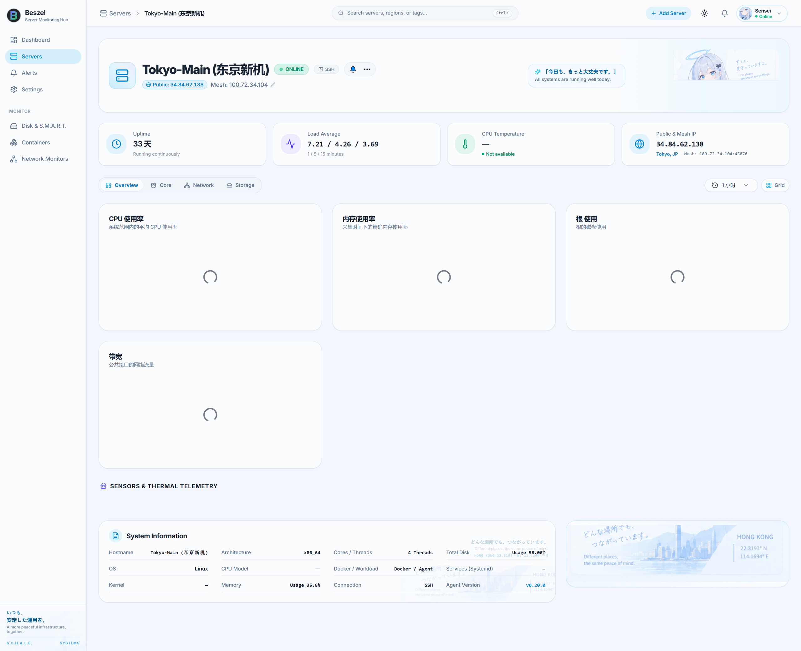
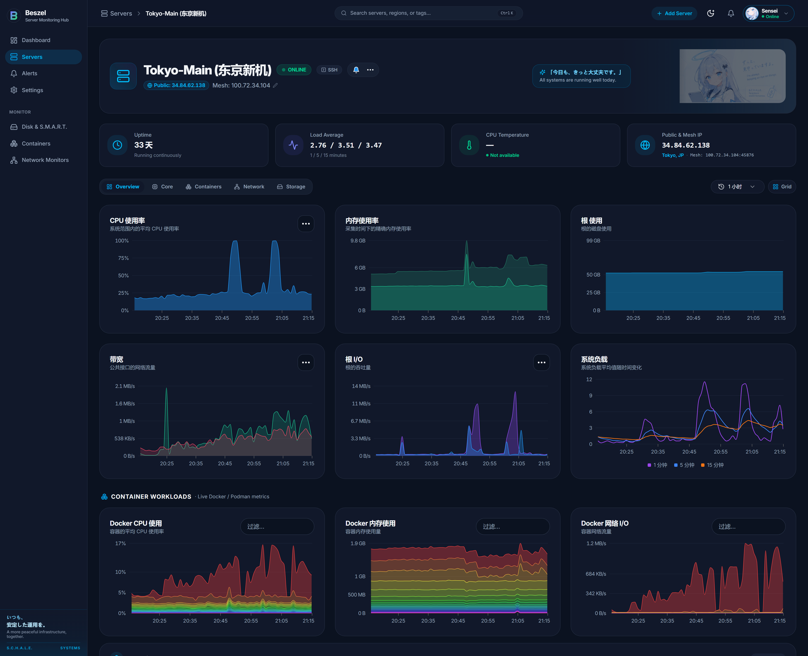
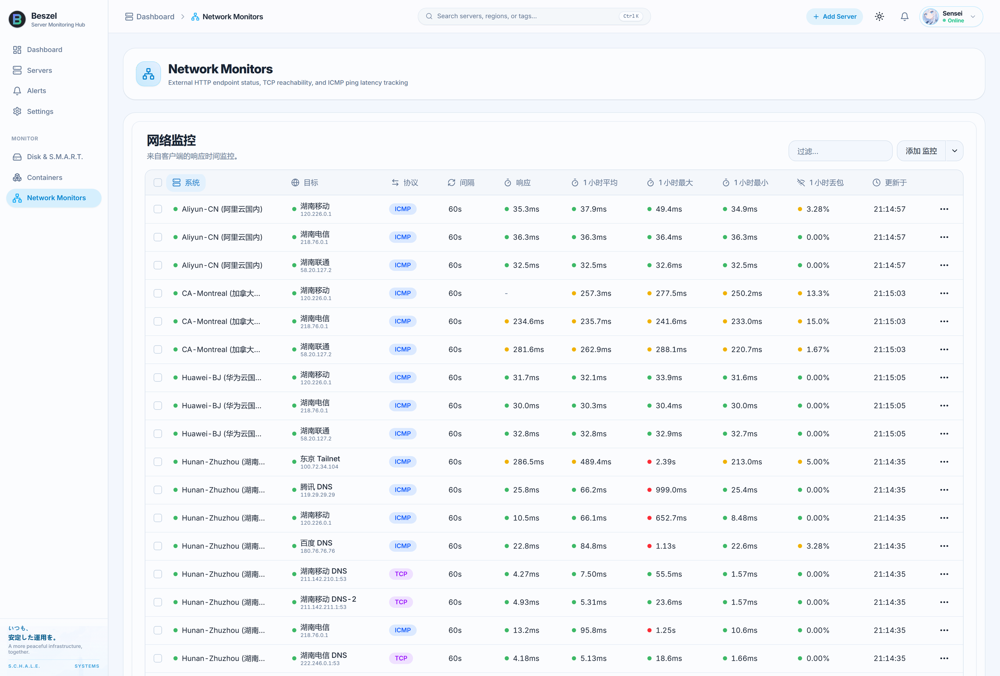
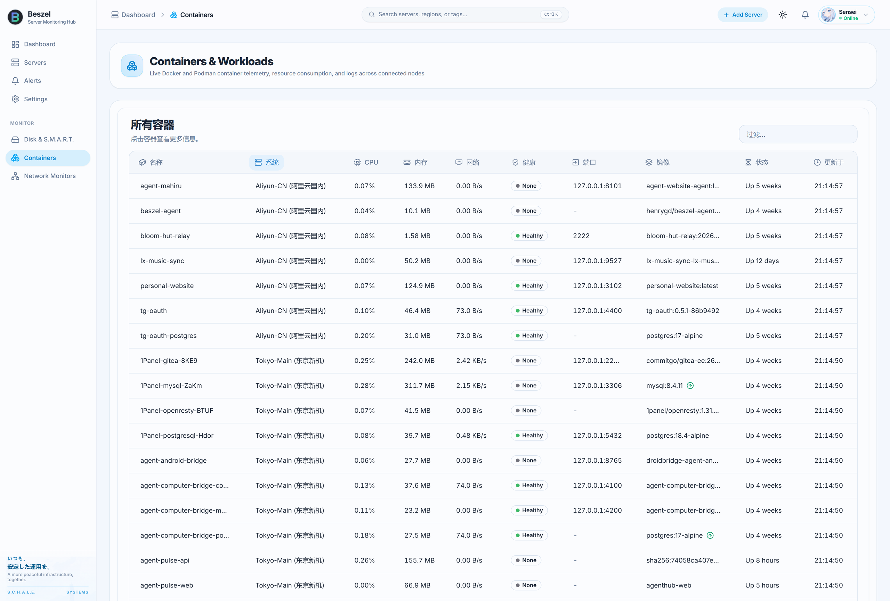
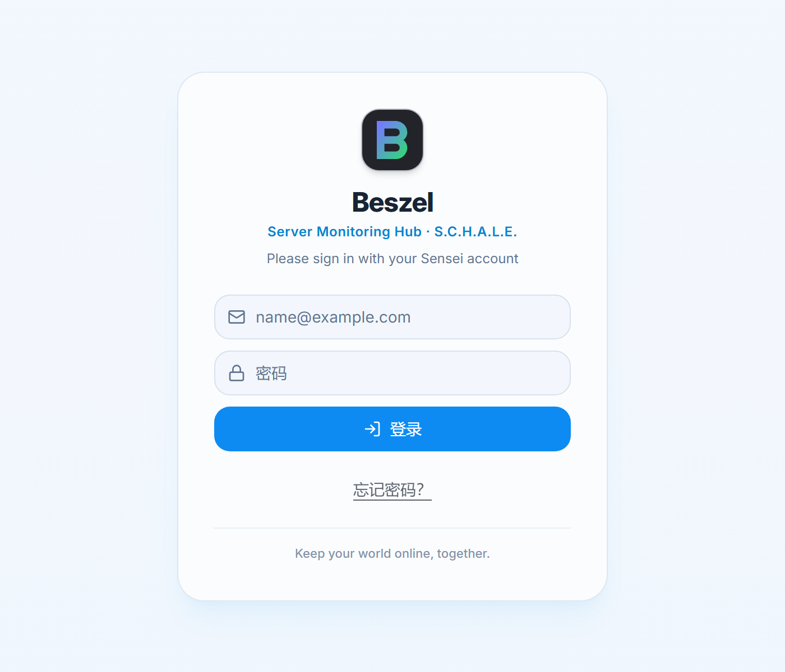

# Beszel (Schale / Aozora UI Edition)

Beszel is a lightweight server monitoring platform that includes Docker statistics, historical data, and alert functions.

This repository is an enhanced edition of Beszel featuring a **complete frontend redesign (Schale / Blue Archive aesthetic)**, high-density matrix server cards, per-second realtime telemetry streaming, multi-ISP network monitor quality bars, and an ambient infrastructure dashboard.

[](https://hub.docker.com/r/henrygd/beszel-agent)
[](https://hub.docker.com/r/henrygd/beszel)
[](https://github.com/henrygd/beszel/blob/main/LICENSE)
[](https://beszel.tannerlab.xyz/)



## Highlights & Features

- **Schale / Blue Archive Aesthetic**: Modern, distinctive visual design featuring Kivotos ambient city backdrop, Arona companion panel, clean micro-textures, and the restored official Beszel gradient brand identity.
- **High-Density Matrix Layout**: 4-column ambient layout, segmented LED hardware-inspired resource meters (CPU, Memory, Root Disk, Load, Network), and quick multi-mode layout switching.
- **Per-Second Realtime Streaming**: Instantaneous metric injection via realtime stream, capturing micro-spikes without waiting for 1-minute aggregation ticks.
- **Multi-ISP Quality Probes**: Built-in ICMP ping / TCP reachability / HTTP monitor matrix with tiered latency and 1-hour packet loss bars for China Telecom, Unicom, and Mobile routes.
- **Dedicated Telemetry Views**:
  - **Containers & Workloads**: Live inspection of all running Docker and Podman containers with container health indicators, port mappings, and memory/CPU limits.
  - **Disk & S.M.A.R.T.**: Array health, wear indicators (including eMMC/NVMe), and Linux mdraid status.
  - **Network Monitors**: Centralized endpoint health, SSL expiration, and latency distribution across distributed nodes.
- **Anti-Stale Version Polling**: Dual-fingerprint (script hash & version) polling with quiet auto-refresh so long-running monitoring tabs stay current without manual intervention.
- **Light & Dark Theme Parity**: Polished dark mode with deep-contrast neon charting and clean airy light mode.
- **Lightweight & Out-of-the-Box**: Minimal resource overhead on both hub and agent, zero heavy dependencies.

## Screenshots

### 1. Dashboard (Light & Dark Mode)

| Light Theme (Schale Ambient) | Dark Theme (Deep Contrast) |
| :---: | :---: |
|  |  |

### 2. Node Telemetry & Time-series Metrics

Comprehensive system metrics including CPU, Memory, Root Disk, Network throughput, Disk I/O, Load Average, and per-container stacked workload charts.

| System Detail (Light) | System Detail (Dark) |
| :---: | :---: |
|  |  |

### 3. Network Monitors & Multi-Node ISP Probe Matrix

Distributed monitoring for external HTTP endpoints, TCP services, and ICMP ping latency with 1-hour packet loss statistics across all nodes.



### 4. Containers & Workloads Overview

Live telemetry for Docker and Podman containers across all monitored hosts, showing health status, resource utilization, and ports.



### 5. Login & Brand Identity



## Architecture

Beszel consists of two main components: the **hub** and the **agent**.

- **Hub**: A web application built on [PocketBase](https://pocketbase.io/) that provides a dashboard for viewing and managing connected systems.
- **Agent**: Runs on each system you want to monitor and communicates system metrics to the hub.

## Getting started

The [quick start guide](https://beszel.dev/guide/getting-started) and other documentation is available on the official website, [beszel.dev](https://beszel.dev).

## Supported metrics

- **CPU usage** - Host system and Docker / Podman containers.
- **Memory usage** - Host system and containers. Includes swap and ZFS ARC.
- **Disk usage** - Host system. Supports multiple partitions and devices.
- **Disk I/O** - Host system. Supports multiple partitions and devices.
- **Network usage** - Host system and containers.
- **Load average** - Host system.
- **Temperature** - Host system sensors.
- **Fan speed** - Host system sensors (Linux, via `/sys/class/hwmon`).
- **GPU usage / power draw** - Nvidia, AMD, and Intel.
- **Battery charge** - Host system and some peripherals.
- **Containers** - Status and metrics of all running Docker / Podman containers.
- **S.M.A.R.T.** - Host system disk health (includes eMMC wear/EOL and Linux mdraid array health via sysfs when available).
- **ZFS** - Pool capacity, usage, health, I/O throughput, scrub status, and per-dataset usage.

## 部署指引 (Aozora UI 定制版)

本项目 Hub 端深度集成 Aozora UI 风格监控前端（蔚蓝档案世界观轻二次元天际线氛围、高密度分段 LED 矩阵卡片、`rt_metrics` 秒级实时指标流、探针多线路质量矩阵与三模式自由切换）。

在线体验演示站点：[https://beszel.tannerlab.xyz/](https://beszel.tannerlab.xyz/)

### 推荐：使用预构建 Docker 镜像部署

在 `docker-compose.yml` 中使用 GHCR 预构建镜像：

```yaml
services:
  beszel:
    image: "ghcr.io/xiaoran7/beszel:latest"
    container_name: "beszel"
    restart: unless-stopped
    ports:
      - "8090:8090"
    volumes:
      - ./beszel_data:/beszel_data
```

启动命令：
```bash
docker compose up -d
```

> **提示**：如果之前拉取过官方 `henrygd/beszel` 镜像，请将 `image` 替换为 `ghcr.io/xiaoran7/beszel:latest` 并执行 `docker compose pull && docker compose up -d` 即可平滑换新。

## Help and discussion

- 官方问题报告与功能建议：[GitHub issues](https://github.com/henrygd/beszel/issues)
- 社区讨论与支持：[GitHub discussions](https://github.com/henrygd/beszel/discussions) 或 Matrix: `#beszel:matrix.org`。

## License

Beszel is licensed under the MIT License. See the [LICENSE](LICENSE) file for more details.

## 本地维护入口

本目录保留上游项目说明。Go 工具链以 `go.mod` 为准；实现分布于 `agent/` 与 `internal/`，辅助资源位于 `supplemental/`。修改前先核对本地 Git 差异；项目约束见 [AGENTS.md](AGENTS.md)。

